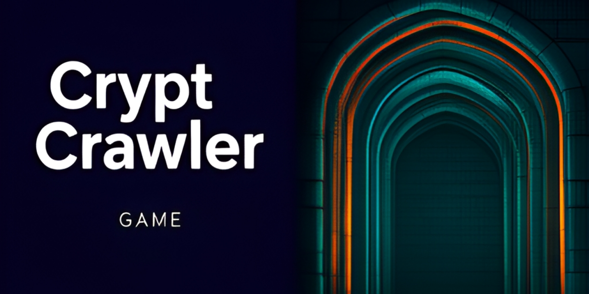
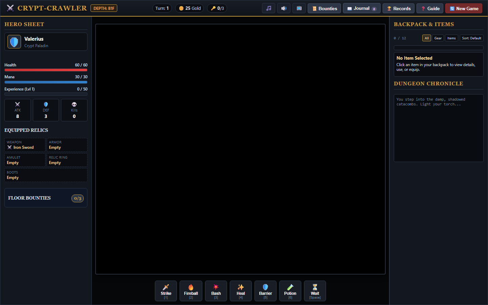

# crypt-crawler

<!-- aegean:media:start -->
<p align="center"></p>
<p align="center"><a href="LICENSE"></a> <a href="https://github.com/AegeanWorks/AIKit"></a></p>
<!-- aegean:media:end -->


Tactical turn-based web dungeon crawler with procedural levels, per-floor omens, a turn-cost trap search and disarm, mimic chests, a two-way merchant, seed replay, five-slot equipment, side-by-side loot comparison, filterable inventory, a persistent lore codex, branching soul encounters, risk-for-power black pact altars, sigil-sealed vaults, hover-annotated props, ranged and lunging enemies, phased boss fights, and headless browser inspection.

## ⚡ 30-Second Cold-Start Quick Reference

- **Runtime Prerequisites**: Python 3.10+ (Standard Library only for runtime; Playwright with Edge for visual UI inspection)
- **Canonical Regression Shield Gate**:
  ```bash
  python -m unittest discover -s tests
  ```

### 🎮 One-Click Launch
- **Windows**: Double-click `PLAY.bat` (automatically detects Python, starts server, and launches default browser)
- **Linux/macOS**: Run `./play.sh`
- **Manual Command**:
  ```bash
  python run.py --open
  ```

### 📸 Headless Browser UI Review & Inspection
```bash
python tools/inspect_ui.py --viewports desktop,laptop,mobile --scenario all --out .inspect
```
The inspector runs the full interactive audit, reports every audit check and exits non-zero when any check or console error fails, so it can gate a commit.

### 🤖 AI Mechanics Harness (deterministic, JSON in / JSON out)
```bash
python tools/ai_harness.py catalog
python tools/ai_harness.py play --seed 42 --class paladin --actions @actions.json
python tools/ai_harness.py play --script run.json
python tools/ai_harness.py selftest
```
`catalog` prints the classes, the five deck abilities, every action field, the pact choices and the state keys. `play` drives the shipped JavaScript engine in headless Edge, installs a seeded `Math.random`, and prints one JSON object per run: each step plus the final state (player, monsters, props, log tail, `layout_hash`). Because the RNG is seeded, the same seed and action list reproduce the same dungeon, so an agent can test a mechanic, change the code, and diff the result; `layout_hash` fingerprints every seeded decision, including rooms, monsters, props, merchants, traps and sconces. `selftest` proves the harness and the mechanics it exposes (layout determinism, deck labels per class, all three pact bargains surviving turns, boss damage, save round-trip, Scroll of Inferno consumption, number-row hotkeys casting instead of moving, numpad movement, single-flight floor descent and new-run precedence) and exits non-zero on any failure. Script file shape:
```json
{"seed": 42, "depth": 1, "class": "rogue",
 "actions": [{"action": "move", "dx": 1, "dy": 0}, {"action": "ability", "slot": 2}]}
```
`use_item` takes a zero-based backpack index; `player.inventory` in the reply is in the same order, and an index shifts after a consumable is removed.
Actions come from `--script run.json` or `--actions @file`; PowerShell and `cmd` strip the inner quotes of a literal JSON argument, so the file forms are the shell-safe ones and an inline parse error says so. Every action is validated before a browser starts, a rejected action (for example `teleport` into a wall) is reported in `steps[].error` with exit 1 instead of a traceback, and an uncaught page error fails the run. Playwright with Edge is only needed for `play` and `selftest`; `catalog` and the unit tests run on the standard library.

### 🧱 UI Guard (AIKit `aikit ui`)
`.aikit/ui.json` declares the `game-ui` surface (`static/**`), the protected paths, the fast proof (`python -m unittest discover -s tests`) and the inventory command (`python tools/ui_inventory.py`), which prints one stable line per control, choice, handler group and theme token.
```bash
cd ..            # AIKit root
python aikit.py ui begin crypt-crawler --surface game-ui
python aikit.py ui verify crypt-crawler      # add --json for stable finding codes
python aikit.py ui finish crypt-crawler --reviewed
python aikit.py ui abort crypt-crawler
```
`begin` needs a clean, green baseline; `verify` rejects edits outside the surface, protected-path changes, diff-budget overruns, a lost inventory entry, hardcoded colours outside the theme paths, and a failed proof; `finish` also records the human review. Delivery guards (`check --strict`, `publish`) refuse an open UI task; this project already sets `ui_required: true`, so a finished `game-ui` task is part of delivery.

### 📱 Mobile Layout
Below 768px the three panels stack into one vertically scrolling column; the action deck and the on-screen movement D-pad stay fully visible above it, and the header wraps instead of overflowing sideways.

### 🎲 Seeds
The class-selection screen accepts an optional positive run seed; leave it blank for a random run. The same seed and class reproduce the same dungeon, and the Records modal shows the current seed with a **Copy Seed** button so a run can be replayed or shared.

### 🎭 Floor Omens, Mobs and Story
Every floor carries one omen chosen deterministically from the seed: **Blood Moon** (enemies strike 25% harder), **Deep Fog** (lantern 5 tiles), **Gilded Crypt** (+50% chest and urn gold) or **Restless Dead** (one extra enemy). The header pill names it, the chronicle announces it, and the journal keeps it.

| Enemy | From | Behaviour |
|---|---|---|
| Skeletal Archer | B2F | Fires a bone arrow up to 4 tiles when it has line of sight; does not close to melee |
| Crypt Hound | B2F | Lunges two tiles per turn and never lets the scent go |
| Gilded Mimic | any chest | Disguised as a chest; opening it springs a scaled fight instead of loot |
| Pact-Bound Wraith | any | Raised in pairs by the Pact of Avarice and hunts the debtor |

Chests can be **Gilded Mimics**: opening one pushes you back and springs a depth-scaled fight instead of paying gold. The mimic is chosen deterministically from the run seed and chest order, so a known seed reproduces the same trapped chest. Trap search reveals traps, not mimics.

QoL: `?` opens the guide, `R` searches for traps, `Escape` closes any dialog, and the 🎞️ header button toggles reduced motion (persisted, disables screen shake and pulsing accents). Story: three new codex entries — *Signs in the Blood*, *The Lantern-Keeper* and *The Debt of Malakor* — and a victory epilogue that closes the ledger.

### 🔍 Trap Search
Press `R` or the deck's **Search** button to spend a turn revealing armed traps within three visible tiles. A revealed trap gets a dashed amber grille and a hover card, but it still triggers if stepped on: the search buys information, not safety. Press `R` again while beside a revealed trap to disarm it for a little XP; the trap becomes a grey crossed grille, is safe to cross, and stays disarmed in saves. The revealed state survives saves; each new floor starts with fresh hidden traps. Deep Fog shortens the search because it uses the same line of sight as the lantern.

### 🧳 Merchant
Hermit Grimbold opens a two-tab shop on B2F and deeper. **Buy** spends gold on potions, gear and relics; **Sell** converts outclassed backpack loot into gold at a rarity-based price (common 10, rare 30, epic 60). The shop stays open after a sale, so a full 12-slot backpack can be cleared in one visit, and selling is refused once the shop is closed. The Crown of Eternity is a trophy, not stock: it never appears in the Sell tab.

### 🛠️ AIKit Commands (run from the AIKit folder)
| Role | Command |
|---|---|
| Status, task and gates | `python aikit.py status crypt-crawler` |
| Phase 4: every gate | `python aikit.py check crypt-crawler` |
| Repair memory and map, then check | `python aikit.py fix crypt-crawler` |
| Resume an interrupted task | `python aikit.py resume crypt-crawler` |

The `mechanics` gate runs `python tools/ai_harness.py selftest`, declared in `.aikit/project.json` as `mechanics.core` (the headless rules: `crawler`, `static/js`, `tools/ai_harness.py`) and `mechanics.test`, so a mechanics regression fails the same gate set as the unit suite.

## 📦 What's Inside

```text
crypt-crawler/
├── .gitignore                <- transient state & screenshots excluded
├── assets/                   <- reviewed logo, social preview and screenshots
├── LICENSE                   <- Aegean Game License 1.1 (AGL-1.1): DRM-free personal play
├── LICENSES/                 <- REUSE license texts
├── REUSE.toml                <- Machine-readable SPDX metadata
├── ASSETS.md                 <- Asset/data manifest: what the license covers
├── PLAY.bat                  <- Windows one-click launcher
├── play.sh                   <- POSIX one-click launcher
├── README.md                 <- documentation and quickstart
├── COMMERCIAL.md
├── run.py                    <- lightweight HTTP server entrypoint
├── crawler/                  <- Python engine package
│   ├── __init__.py
│   ├── dungeon.py            <- procedural dungeon generator
│   ├── entities.py           <- player and monster simulation
│   ├── combat.py             <- combat calculations and status effects
│   ├── lore.py               <- codex entries, pact altars and discovery events
│   ├── rewards.py            <- variable-ratio jackpots, near-miss & bounties
│   └── server.py             <- HTTP request handler & REST endpoints
├── static/                   <- Web UI assets (zero build step)
│   ├── index.html            <- modern responsive HTML5 shell
│   ├── css/
│   │   └── style.css         <- dark fantasy UI, glowing HUD, layout
│   └── js/
│       ├── engine.js         <- game loop, turn management, state
│       ├── dungeon.js        <- client dungeon state & fog of war
│       ├── renderer.js       <- procedural canvas tiles & lighting
│       ├── ui.js             <- HUD, inventory panel, combat log
│       └── audio.js          <- Web Audio API synthetic SFX synthesizer
├── tools/
│   ├── inspect_ui.py         <- Playwright headless Edge UI inspector
│   ├── ai_harness.py         <- seeded JSON gameplay harness for agents
│   └── ui_inventory.py       <- deterministic control/handler inventory
├── tests/
│   ├── __init__.py
│   ├── test_ai_harness.py    <- harness validation and UI inventory tests
│   ├── test_combat.py        <- combat rules tests
│   ├── test_dungeon.py       <- procedural generation tests
│   ├── test_inspect.py       <- inspection configuration tests
│   ├── test_lore.py          <- codex data and /api/lore endpoint tests
│   ├── test_rewards.py       <- reward jackpots, near-miss & bounty tests
│   └── test_server.py        <- web server endpoints tests
└── .aikit/                   <- project memory: record, ledger, decisions, ui.json guard
```

<!-- aegean:brand-assets:start -->
## 🎨 Brand Assets

> **AI-Generated Brand Artwork.** The banner and logo are **AI-generated brand assets**. They are illustrative and may not literally depict every feature or the full project scope.
<!-- aegean:brand-assets:end -->

## 📜 License

Free for personal play under the Aegean Game License 1.1 (AGL-1.1); see [LICENSE](LICENSE). It is DRM-free: Licensor ships no DRM and a distributor may not add it. Streaming, modding and free mods are allowed. Commercial use, paid mods and AI training need the Aegean Commercial License 1.0 (ACL-1.0); see [COMMERCIAL.md](COMMERCIAL.md).

<!-- aegean:screenshots:start -->
## Screenshots

<a href="https://github.com/AegeanWorks/Crypt-Crawler/commit/941f16f"></a>

*commit `941f16f` · 2026-10-28*
<!-- aegean:screenshots:end -->
